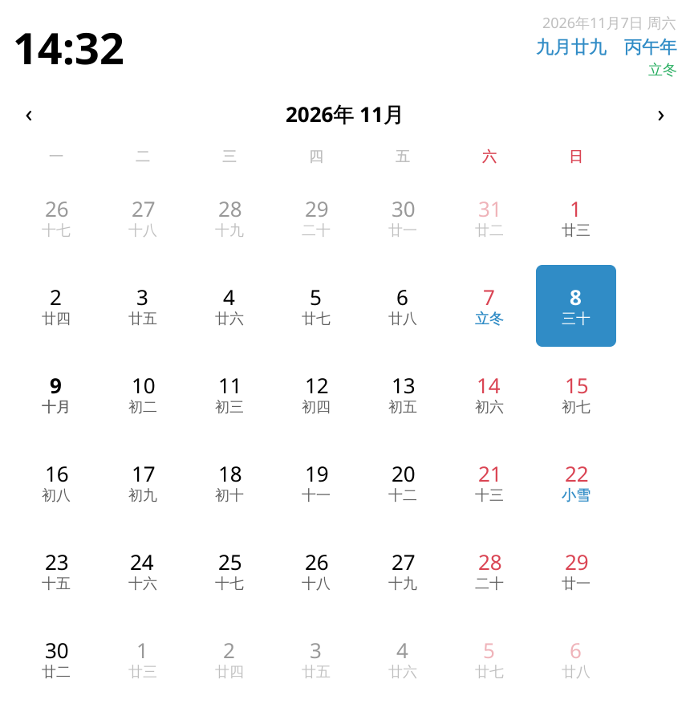
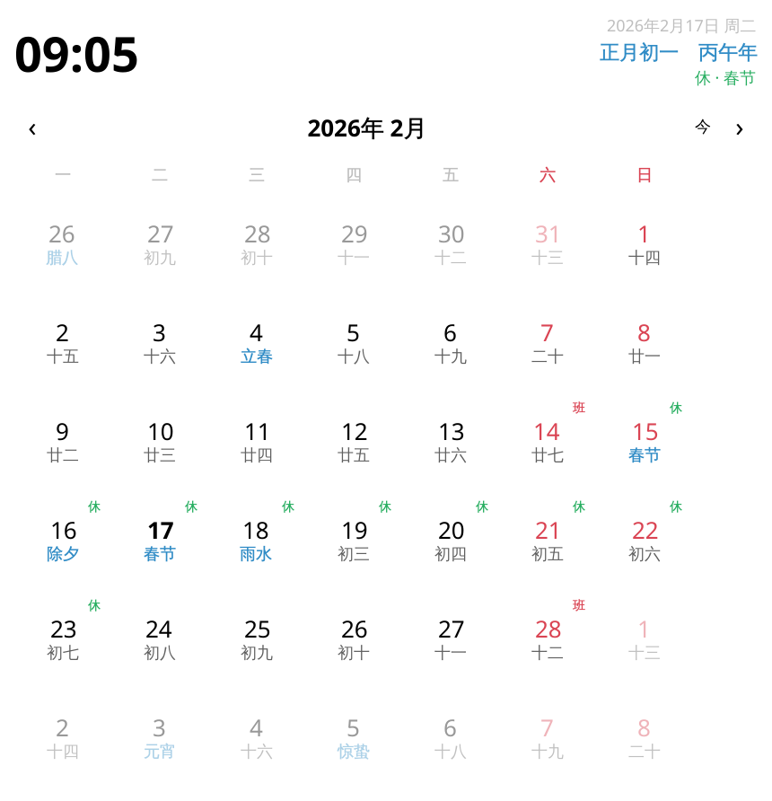

<p align="center"></p>

<h1 align="center">农历时钟 · Chinese Calendar Clock</h1>

[](LICENSE)
[](https://kde.org/plasma-desktop/)
[](https://github.com/yuanphoenix/plasma-Chinese-Calendar-clock/actions/workflows/update-holidays.yml)

一个 KDE Plasma 6 桌面部件：**面板上就是个数字时钟，悬停显示农历，点开是带节假日与调休的中式月历。**

补的是 Plasma 6 的一个空缺——KDE 5 的时钟日历有「备用日历 / 中国农历」，Plasma 6

> **English:** a KDE Plasma 6 panel clock with the Chinese lunisolar calendar: lunar day/month, 24 solar terms, traditional festivals, and the State Council statutory holidays and make-up workdays (调休). Panel shows time only, hover for the lunar date, click to open a month grid.

| 面板（紧凑） | 点击展开 |
| --- | --- |
|  |  |

春节假期（休 / 班 角标）：



## 功能

- **面板只显示时间**：`HH:mm`，可选第二行（农历日 / 公历日期）
- **点击展开 / 再点收起**：面板部件自己处理点击（Plasma 6 不会代劳）
- **悬停提示**：农历几月几日 + 干支 + 生肖 + 节气 + 今日放假/调休
- **月历**：
  - 每格公历日 + 农历日；初一显示月名（十月），闰月标「闰」
  - 二十四节气（天文算法实时计算，非查表）
  - 传统节日：春节、元宵、龙抬头、端午、七夕、中元、中秋、重阳、腊八、除夕
  - **国务院法定节假日与调休**：放假标「休」、调休上班标「班」，连休首日显示节日名
  - 今天高亮、周末红色、前后月淡显、悬停显示当日详情、点前后月的日期可跳月
- 配色全部取自 Plasma 主题（跟随深浅色与主色调），不硬编码颜色

## 安装

### 从 KDE Store（推荐给普通用户）

系统设置 → 面板 → 添加部件 → 获取新部件 → 搜索「Chinese Calendar Clock」。

### 从源码

```sh
git clone https://github.com/yuanphoenix/plasma-Chinese-Calendar-clock.git
cd plasma-Chinese-Calendar-clock
./scripts/install.sh
```

然后：右键面板 → **添加部件** → 搜索「农历时钟」→ 拖到面板上。

已经放着旧版本时，装完执行 `systemctl --user restart plasma-plasmashell` 重新加载。

### 用打包文件

```sh
./scripts/build-package.sh
kpackagetool6 --type Plasma/Applet --install dist/io.github.yuanphoenix.lunarclock-*.plasmoid
```

## 配置

右键部件 → 配置农历时钟：

| 选项 | 默认 | 说明 |
| --- | --- | --- |
| 显示秒 | 关 | 面板时间是否带秒 |
| 面板第二行 | 不显示 | 只显示时间时最像数字时钟；可改农历日或公历日期 |
| 面板字号 | 标准 | 小 / 标准 / 大 |
| 显示传统节日 | 开 | 月历里是否标春节、中秋等 |
| 显示二十四节气 | 开 | 月历里是否标立春、冬至等 |
| 显示放假/调休角标 | 开 | 是否显示「休」「班」 |
| 显示干支纪年 | 开 | 悬停与展开视图里的「丙午年 · 属马」 |

## 数据来源与精度

| 内容 | 实现 | 精度 |
| --- | --- | --- |
| 农历换算 | `contents/js/lunar.js`，内置 1900–2099 年农历表 + 逐月推算 | 1950–2099 逐日对拍 54,787 天，仅 1954 / 1978 / 2057 / 2060 四个有争议年与部分库不一致；1979–2049 随机 400 天与 Debian `lunar` 程序 0 差异 |
| 二十四节气 | Meeus 太阳视黄经算法（含光行差与章动修正）实时求解 | 2000–2049 共 1200 个日期对拍权威程序，596/600 个「节」完全一致，4 个交节时刻距午夜不足 10 分钟的年份差一天 |
| 节假日与调休 | `contents/js/holidays.js`，由脚本从 [liriansu-opus/chinese-calendar](https://github.com/liriansu-opus/chinese-calendar) 生成 | 覆盖 2004–2027（随上游更新） |

### 更新节假日数据

国务院每年 11 月前后公布次年安排，上游 `chinese-calendar` 随之发版。之后：

```sh
python3 scripts/gen-holidays.py     # 重新生成 contents/js/holidays.js
./scripts/install.sh
systemctl --user restart plasma-plasmashell
```

仓库里配了 GitHub Action（`.github/workflows/update-holidays.yml`）：每周一自动检查一次，数据有变化就开 PR；数据没覆盖到次年时 CI 变红提醒。**别手改 `holidays.js`**，它每次都会被覆盖。

## 目录结构

```
metadata.json                 部件清单（Id: io.github.yuanphoenix.lunarclock）
contents/
  config/main.xml             配置项定义
  js/lunar.js                 农历 / 节气 / 干支 / 节日（纯函数，可 node 单测）
  js/holidays.js              节假日与调休（脚本生成，勿手改）
  ui/main.qml                 部件入口：紧凑 = 时钟，展开 = 时钟 + 月历
  ui/ClockCompact.qml         面板里的时钟
  ui/ClockHeader.qml          展开视图顶部（时间 + 日期 + 农历）
  ui/CalendarView.qml         月历网格（可独立渲染）
  ui/configGeneral.qml        配置界面
scripts/
  gen-holidays.py             生成 holidays.js（--require-year 供 CI 用）
  install.sh                  安装 / 更新到 ~/.local/share
  build-package.sh            打包 .plasmoid
  render-preview.sh           生成 preview/ 截图（offscreen 渲染，无需 Plasma 会话）
  preview-*.qml               渲染用的临时窗口
.github/workflows/
  update-holidays.yml         节假日数据自动更新
assets/                      logo（svg + 多尺寸 png）与 GitHub 封面图
preview/                     README 截图
docs/                         投稿用文案
```

## 开发

`lunar.js` / `holidays.js` 都是纯函数，可以直接用 node 测：

```sh
sed '1d' contents/js/lunar.js > /tmp/lunar.js
node -e 'const L=require("/tmp/lunar.js"); console.log(L.solarToLunar(2026,11,7))'
```

改界面后生成预览图（需要 `apt install qml-qt6`）：

```sh
./scripts/render-preview.sh
```

三个容易踩的坑，记在这里：

1. 面板部件的宽度必须绑到内容（`implicitWidth` / `Layout.minimumWidth`），否则面板按 0 宽布局、内容溢出被裁；
2. 点击展开要自己用 `MouseArea` 翻转 `expanded`，Plasma 6 不再替部件处理点击；
3. 配置页必须在 `contents/config/config.qml` 里用 `ConfigModel` 声明（`source` 相对 `contents/ui/`）。**光有 `configGeneral.qml` 不会被加载**——配置对话框只会显示「关于」和「快捷键」两个内置页，看起来就像没有任何选项。

## 许可

本仓库代码以 **GPL-2.0-or-later** 发布，见 `LICENSE`。

`contents/js/holidays.js` 由 [chinese-calendar](https://github.com/liriansu-opus/chinese-calendar)（MIT）的数据生成，该数据的著作权归其作者所有；本仓库仅做格式转换并保留此声明。
